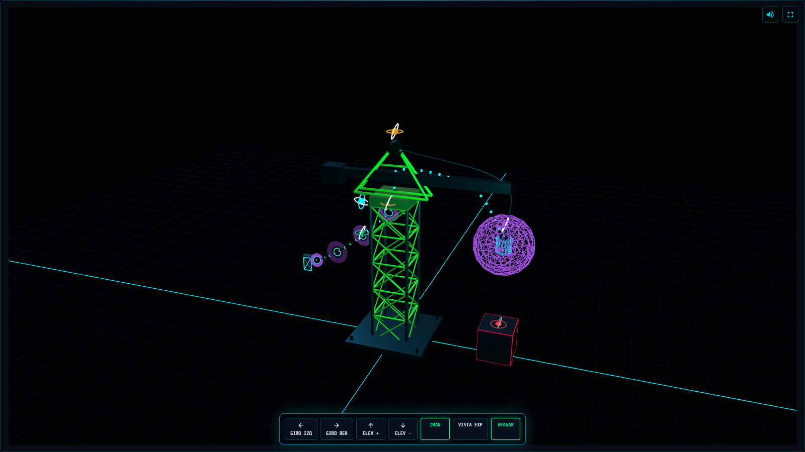

<div align="center">

# ⚡ Electromagnetic Simulator

### Interactive 3D Electromagnetic Crane

**An educational web application for exploring electromagnetic principles through interactive 3D visualization and simulation.**

[Live Demo](https://waltdev16.github.io/Electromagnetic_Simulator/) · [Source Code](https://github.com/waltdev16/Electromagnetic_Simulator)

<br>



</div>

---

## About the Project

Electromagnetic Simulator is an interactive educational project that demonstrates the operation of an electromagnetic crane.

The application combines a 3D crane model, an industrial-style control panel, and visual representations of fundamental electromagnetic principles.

The project was developed in the context of **Expotecnia 42 — Instituto Emiliani**.

## Technologies Used

| Technology | Purpose |
|---|---|
| HTML5 | Web structure and interactive interface |
| CSS3 | Styling, layouts, and responsive design |
| JavaScript | Application logic and user interactions |
| Three.js | 3D crane modeling and rendering |
| WebGL | Browser-based 3D graphics |
| Chart.js | Visualization of simulation variables |
| GSAP | Interface animations |
| MathJax | Rendering mathematical expressions |
| Web Audio API | Interactive sound effects |

## Features

- **Interactive 3D Crane:** Explore the electromagnetic crane from different camera angles.
- **Industrial Control Panel:** Operate the simulation through an interactive interface.
- **Motor Controls:** Simulate crane rotation and lifting movements.
- **Electromagnet Activation:** Turn the magnetic system on and off.
- **Component Exploration:** Inspect parts of the crane and their functions.
- **Physics Visualization:** Explore electromagnetic principles through explanatory content.
- **Telemetry Dashboard:** View simulated physical variables using charts.
- **Interactive Animations:** Visual effects and transitions.
- **Audio Feedback:** Simulated operating sounds.
- **Educational Content:** Learn how electromagnetic cranes work and where they are used.

## Physics Concepts

The project introduces several physical principles:

- **Ampère's Law:** Magnetic fields generated by electric currents.
- **Faraday's Law:** Electromagnetic induction.
- **Lorentz Force:** Interaction between magnetic fields and electric charges.
- **Joule Heating:** Thermal energy generated by electrical resistance.

The displayed telemetry is based on simplified simulation models and reference parameters. It should not be interpreted as validated measurements from industrial equipment.

## Development Process

### 1. Research and Planning

Study the operating principles of electromagnetic cranes and identify the components required for an interactive educational simulation.

### 2. 3D Modeling

Construct the crane using Three.js geometry, materials, lighting, and camera controls.

### 3. Interactive Controls

Implement JavaScript interactions for crane movement, power controls, and electromagnet activation.

### 4. Physics and Telemetry

Develop simplified calculations and graphical representations of selected electromagnetic phenomena.

### 5. Web Interface

Integrate the 3D simulation into a responsive educational website with explanatory sections and an industrial-style dashboard.

## What I Learned

This project provided opportunities to explore:

- Building interactive 3D environments with Three.js.
- Understanding the fundamentals of WebGL rendering.
- Working with camera movement, lighting, and 3D objects.
- Connecting user interfaces with JavaScript-driven simulations.
- Visualizing information through charts.
- Organizing a web application into multiple components.
- Applying physics concepts to an educational software project.
- Using GitHub Pages to publish web applications.

## Running the Project

### Option 1 — Live Demo

Open the deployed application:

https://waltdev16.github.io/Electromagnetic_Simulator/

### Option 2 — Run Locally

Clone the repository:

```bash
git clone https://github.com/waltdev16/Electromagnetic_Simulator.git
cd Electromagnetic_Simulator
```

Run a local web server:

```bash
python -m http.server 8000
```

Open the following address in your browser:

http://localhost:8000/

A modern browser with WebGL support and an internet connection to load the external libraries is recommended.

## Project Structure

```text
Electromagnetic_Simulator/
├── css/
│   ├── crane-simulator.css   # 3D viewer styles
│   └── electrogrua.css       # Educational website styles
├── js/
│   ├── crane-simulator.js    # Three.js crane and 3D interactions
│   ├── control-panel.js      # Industrial controls and telemetry
│   └── site-effects.js      # Navigation and visual effects
├── index.html                # GitHub Pages entry point
├── electrogrua.html          # Main educational application
├── simulator-3d.html         # Standalone Three.js viewer
└── README.md                 # Project documentation
```

### Architecture

The application separates its functionality into three main layers:

- **Presentation:** `electrogrua.html`, `electrogrua.css`, and `site-effects.js` provide the educational interface, navigation, and animations.
- **Simulation Controls:** `control-panel.js` manages the industrial dashboard, user interactions, sound effects, and physics-based telemetry.
- **3D Visualization:** `simulator-3d.html`, `crane-simulator.js`, and `crane-simulator.css` render and animate the electromagnetic crane using Three.js.

The control panel communicates with the embedded 3D simulator through the browser's `postMessage` API.

## Future Improvements

- [ ] Organize the JavaScript and CSS into dedicated folders.
- [ ] Improve performance on mobile devices.
- [ ] Add more detailed explanations of the simulation models.
- [ ] Introduce configurable electromagnetic parameters.
- [ ] Improve accessibility and keyboard navigation.
- [ ] Add automated tests for simulation calculations.
- [ ] Include a complete video demonstration.
- [ ] Expand the technical documentation.

## Demo Video

*A video demonstration will be added soon.*

## Project Context

Developed as an educational technology project for **Expotecnia 42 — Instituto Emiliani**.

---

<div align="center">

**Exploring the intersection of software development, 3D visualization, and physics.**

</div>
